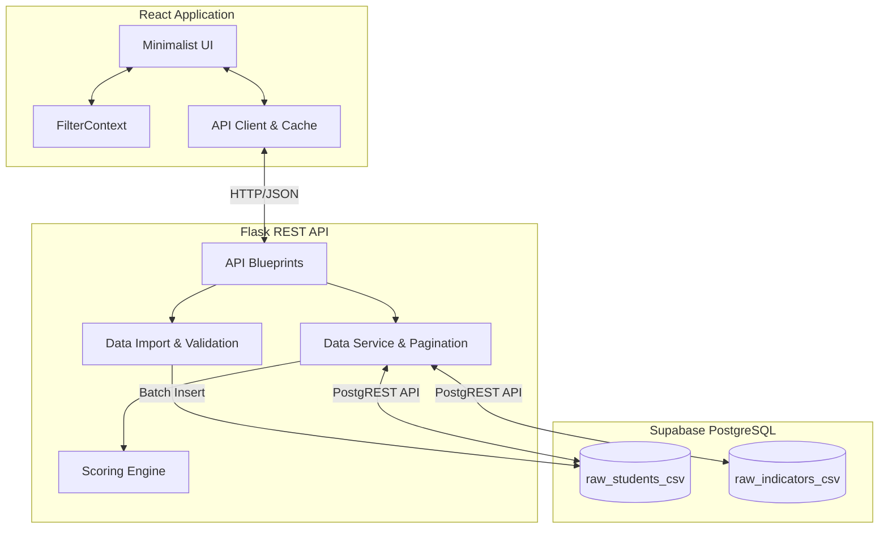

# StudentArc - Architecture

## Data Flow
1. **Import:** `CampusPulse_Combined_Master.csv` (source institutional dataset) is uploaded via React. Flask drops legacy columns, checks for duplicates and nulls, and streams insertion to Supabase.
2. **Analysis:** When the Dashboard mounts, Flask's `DataService` fetches all records (paginating past 1000-row limits).
3. **Scoring:** Missing indicators are dropped dynamically from denominators (preventing unfair 0-scores). Duplicate indicator observations are deduplicated. Success, Academic, and Placement scores are computed on the fly.
4. **Presentation:** The frontend renders strict, black-and-white React/Recharts visualizations. Users interact by clicking charts to filter context globally, drilling down into individual `StudentProfiles`.
