# StudentArc

**AI-Powered Student Analytics and Success Platform**  
*Smart Campus Analytics: Predict, Optimize & Improve Student Success*

---

[](https://kpmg.com)
[](https://react.dev)
[](https://flask.palletsprojects.com)
[](https://supabase.com)
[-brightgreen.svg)]()

> **Note on Historical Context:** StudentArc was previously developed under the working title *CampusPulse AI*. The platform has been comprehensively rebranded, hardened, and expanded into StudentArc for the **HacXLerate 2026 Round 1** evaluation.

---

## Table of Contents

- [A. Project Overview](#a-project-overview)
- [B. Problem Statement](#b-problem-statement)
- [C. Solution and Objectives](#c-solution-and-objectives)
- [D. Technology Stack](#d-technology-stack)
- [E. Key Features and Application Pages](#e-key-features-and-application-pages)
- [F. System Architecture](#f-system-architecture)
- [G. Student Success Score and Risk Methodology](#g-student-success-score-and-risk-methodology)
- [H. Data Sources and Data Quality](#h-data-sources-and-data-quality)
- [I. AI Insight Brief (Gemini Integration)](#i-ai-insight-brief-gemini-integration)
- [J. Database and Backend APIs](#j-database-and-backend-apis)
- [K. Installation and Local Setup](#k-installation-and-local-setup)
- [L. Team Members and Roles](#l-team-members-and-roles)
- [M. KPMG Challenge Alignment](#m-kpmg-challenge-alignment)
- [N. Known Limitations and Future Improvements](#n-known-limitations-and-future-improvements)
- [O. Security and Data Privacy](#o-security-and-data-privacy)
- [P. Recommended 3–5 Minute Demo Guide](#p-recommended-35-minute-demo-guide)
- [Q. Acknowledgements](#q-acknowledgements)

---

## A. Project Overview

Higher education institutions routinely collect large volumes of student data across disconnected touchpoints: semester examination results, daily attendance logs, Learning Management System (LMS) engagement footprints, placement mock assessments, technical skills evaluations, and faculty/student feedback. In typical campus operations, these data streams remain trapped in institutional silos. Faculty mentors and department chairs often only discover that a student is struggling after semester backlogs accumulate or after placement season concludes.

**StudentArc** is an end-to-end student analytics and success platform engineered to solve this fragmentation. It unifies disparate academic, behavioural, and career-readiness data into a single, cohesive institutional intelligence cockpit. 

By calculating a transparent, multi-dimensional **Student Success Score (0–100)**, an **Academic Performance Score (0–100)**, a **Learning Engagement Score (0–100)**, and an independent **Placement Readiness Score (0–100)**, StudentArc equips university administrators and academic mentors to:
1. Detect academic and placement risks early in the semester.
2. Understand the exact underlying drivers behind every risk flag through explainable metrics.
3. Group students into actionable cohorts (e.g., academically strong but placement-unprepared).
4. Review grounded, personalized AI Insight Briefs powered by Google Gemini (with an immediate rule-based fallback).
5. Institute, assign, and track targeted faculty intervention plans.

> **Important Analytical Disclaimer:** All scores, thresholds, and risk designations in StudentArc are **deterministic analytical indicators** designed to assist human educators and advisory committees. They represent diagnostic evaluations based on current available records, not rigid guarantees or fatalistic forecasts of future academic or career outcomes.

---

## B. Problem Statement

StudentArc directly addresses the challenge posed by **KPMG in India**:

> **AI-Powered Student Analytics and Success Platform — Smart Campus Analytics: Predict, Optimize & Improve Student Success**

The core challenges identified in modern campus administration include:
- **Data Fragmentation:** Student indicators live across distinct spreadsheets, legacy ERPs, attendance biometric systems, and external coding platforms without a unified identifier.
- **Inability to Proactively Intervene:** Traditional campus reporting is post-hoc (grades at the end of the semester), leaving zero runway for corrective action or tutoring.
- **Biased / Opaque Scoring:** Naive averages treat missing optional fields (like LMS logins or certifications) as zeroes, penalizing students who attend physical classes or lack access to digital portals.
- **Divergence Between Academics & Employability:** High-CGPA students often struggle in technical coding assessments and mock interviews, while proficient coders may face academic backlog risks.
- **Lack of Actionable Intervention Tracking:** Risk identification rarely connects to recorded faculty follow-ups, resulting in repeated student failures.

Proactive intervention matters because timely academic tutoring, attendance counselling, and mock interview practice have been shown to directly reduce dropout rates and improve corporate placement outcomes.

---

## C. Solution and Objectives

StudentArc addresses these challenges through an 8-stage operational pipeline:

```
[Institutional Data (CSV / ERP)] 
       ↓
1. Smart Import & Header Mapping (Dynamic alias normalization)
       ↓
2. Data Validation & Conflict Resolution (Deduplication & missing data checks)
       ↓
3. Authoritative Scoring Calculation (Missing-data denominator rebalancing)
       ↓
4. Bounded Database Persistence (Supabase PostgreSQL storage)
       ↓
5. Cohort Segmentation (Rule-based actionable student groups)
       ↓
6. Interactive Analytics Dashboards (Cross-filtered Recharts visualizations)
       ↓
7. Grounded AI Insight Briefs (Gemini LLM analysis + Rule-based fallback)
       ↓
8. Faculty Support Plans & Intervention Lifecycle (Actionable remediation tracking)
```

### Functional Scope Matrix

| Capability | Status | Implementation Evidence |
| :--- | :--- | :--- |
| Dynamic CSV Import & Alias Mapping | **Implemented & Verified** | [`backend/services/import_service.py`](backend/services/import_service.py), [`src/pages/DataHub.tsx`](src/pages/DataHub.tsx) |
| Deterministic Scoring Engine | **Implemented & Verified** | [`backend/services/scoring.py`](backend/services/scoring.py) (28 automated pytest unit tests) |
| Missing-Data Weight Rebalancing | **Implemented & Verified** | Proportionally rescales denominators; never penalizes missing fields as 0 |
| Real-Time Dashboard & Cross-Filters | **Implemented & Verified** | [`src/pages/Dashboard.tsx`](src/pages/Dashboard.tsx), Department & Semester global filters |
| Global Search (`Cmd/Ctrl + K`) | **Implemented & Verified** | [`src/components/layout/GlobalSearch.tsx`](src/components/layout/GlobalSearch.tsx) with keyboard arrows & instant jump |
| Student Directory & Radar Visuals | **Implemented & Verified** | [`src/pages/Students.tsx`](src/pages/Students.tsx), [`src/components/students/StudentDetailModal.tsx`](src/components/students/StudentDetailModal.tsx) |
| Student Groups & Actionable Cohorts | **Implemented & Verified** | [`src/pages/StudentGroups.tsx`](src/pages/StudentGroups.tsx) with verified API drill-down |
| Support Plans & Intervention Registry | **Implemented & Verified** | [`src/pages/SupportPlans.tsx`](src/pages/SupportPlans.tsx) with modal creation & Supabase persistence |
| Comprehensive Reports & CSV Export | **Implemented & Verified** | [`src/pages/Reports.tsx`](src/pages/Reports.tsx) across 5 analytical tabs with client-side export |
| Gemini AI Briefs with Fallback | **Implemented & Verified** | [`backend/services/ai_service.py`](backend/services/ai_service.py) with dual LLM/rule-based pathways |
| Longitudinal Semester Tracking | *Planned / Out of Scope* | Dataset provides cross-sectional cohort snapshots rather than multi-year historical logs |

---

## D. Technology Stack

Every component in StudentArc has been verified directly against repository configuration files ([`package.json`](package.json) and [`backend/requirements.txt`](backend/requirements.txt)):

### Frontend
| Technology | Verified Version | Purpose in StudentArc |
| :--- | :--- | :--- |
| **React** | `19.2.8` | Component-driven user interface and reactive state management |
| **Vite** | `8.3.0` | High-speed frontend build tool and development server |
| **TypeScript** | `~6.0.2` | Static type safety and data model contracts across all views |
| **Tailwind CSS** | `4.3.3` | Modern utility styling with custom design tokens for StudentArc |
| **Recharts** | `3.10.1` | Declarative SVG charting (Bar, Pie, Radar, Scatter, Area) |
| **Lucide React** | `1.55.0` | Consistent, accessible iconography |
| **React Router DOM** | `7.18.4` | Single Page Application (SPA) declarative client-side routing |
| **React Markdown** | `10.1.0` | Safe rendering of structured AI-generated insight briefs |

### Backend & Data Services
| Technology | Verified Version | Purpose in StudentArc |
| :--- | :--- | :--- |
| **Python** | `3.12+` | Backend runtime environment |
| **Flask** | `3.0.3` | Lightweight RESTful API server and blueprint routing |
| **Flask-CORS** | `4.0.0` | Cross-Origin Resource Sharing control between Vite and Flask |
| **Pandas** | `2.2.1` | High-performance CSV parsing, type validation, and data wrangling |
| **Supabase (Python SDK)**| `2.4.3` | PostgREST client for PostgreSQL database operations |
| **Pytest** | `8.1.1` | Automated test suite execution (28 passing unit & integration tests) |
| **Google GenAI SDK** | `>=0.2.0` | Official Python SDK interface to Google Gemini models |
| **python-dotenv** | `1.0.1` | Secure local environment variable management |

### Database & Design System
- **Database:** Supabase Managed PostgreSQL
- **Color Palette:**
  - Primary Navy: `#172B4D`
  - Chart Orange: `#F47735`
  - Peach Accent: `#FFB080`
  - Page Background: `#E1E2E5`
  - Content Surface: `#F4F5F7`
  - Card Surface: `#FFFFFF`
  - Muted Slate: `#8793A5`
  - Card Border: `#E4E6EA`
  - Primary Text: `#191919`

---

## E. Key Features and Application Pages

StudentArc features 10 fully interactive, data-driven pages:

### 1. Student Success Dashboard (`/`)
- **Executive KPI Cards:** Real-time totals for Total Students Analyzed (400), Average Success Score (76.8), Academic Support Reviews (54), Placement Support Reviews (225), and Data Completeness (100%).
- **Interactive Visualizations:**
  - *Attendance and Learning Activity:* Compares physical attendance against LMS engagement rates.
  - *Success Score Distribution:* Histogram bucketing students into 10-point bands.
  - *Cohort Performance by Semester:* Average performance across Semesters 1 through 8.
  - *Department Comparisons:* Academic versus placement performance across Computer Science, Business, Mechanical, Civil, and Electronics.
  - *Student Satisfaction Feedback:* Star rating distribution (1 to 5 stars).
- **Priority Review Queue:** Instant list of the top 10 highest-urgency students needing immediate advisor outreach.
- **Global Filters:** Sticky department and semester selectors that update all KPI cards and charts in unison.

### 2. Student Directory & Profile (`/students`)
- **Directory Search & Sorting:** Live search by student name or student ID (e.g., `STU0001`), with department, semester, and risk level filtering.
- **Student Profile Panel & Modal:**
  - Academic metrics (CGPA, backlogs, GPA trend).
  - Learning engagement metrics (Attendance %, LMS logins, assignments).
  - Placement readiness metrics (Coding, aptitude, mock interviews).
  - 5-axis **Radar Competency Chart** mapping individual strengths and weaknesses against institutional averages.
  - Active Support Flags explaining why a student requires assistance.
  - What-If Recalculation engine demonstrating score recovery if backlogs are cleared.

### 3. Global Quick Search (`Cmd / Ctrl + K`)
- Integrated in the top navigation header.
- Instant fuzzy lookup across student records and department rosters.
- Supports keyboard arrow navigation (`↑`, `↓`, `Enter`, `Escape`) and directs straight to student profiles.

### 4. Attendance Overview (`/attendance`)
- Tracks overall institution attendance (average ~75%).
- Low-attendance alerts for students below the 75% regulatory requirement.
- Interactive range sliders and threshold chips for targeted attendance auditing.

### 5. Academic Progress (`/academic`)
- Examines academic indicators independent of placement readiness.
- Visualizes CGPA bands, backlog penalties, and correlation between physical attendance and examination performance.
- Identifies the 54 students flagged specifically for academic support (Academic Score < 60).

### 6. Placement Preparation (`/placement`)
- Evaluates employability across technical and behavioral competencies: coding assessments, aptitude exams, mock interview evaluations, technical skills, and soft skills.
- Pinpoints skill gaps for unplaced students to help career placement cells organize targeted bootcamps.
- Identifies the 225 students flagged for placement assistance (Placement Readiness Score < 60).

### 7. Student Groups & Cohorts (`/segments`)
- Automatically clusters students into actionable intervention cohorts:
  1. **Low Engagement, Decent Academics:** High exam scores but poor attendance/LMS activity (11 students).
  2. **Strong Academics, Weak Placement:** High CGPA (>75) but unprepared for corporate recruitment (<60) (125 students).
  3. **Strong Placement, Weak Academics:** Technically gifted coders risking academic disqualification due to backlogs (0 in current cohort).
  4. **Total Enrolled Cohort:** Complete student population (400 students).
- Selecting any cohort opens a split roster view displaying student evidence tags and recommended group actions.

### 8. Support Plans & Interventions (`/interventions`)
- Resolves the gap between risk detection and institutional action.
- Displays the 225 students requiring active intervention.
- **Action Modal:** Faculty can create personalized support plans, set target dates, assign advisors, define actionable tasks (e.g., "Mandatory mock interview prep"), and track status through `Planned` → `In Progress` → `Completed`.
- Plans persist directly into the Supabase database.

### 9. Reports & Insights (`/reports`)
- Executive reporting center organized into 5 dedicated tabs:
  1. *Academic Performance Report*
  2. *Placement Readiness Report*
  3. *At-Risk & Retention Analysis*
  4. *Cohort & Segment Breakdown*
  5. *Data Quality & Audit Trail*
- Includes an AI-generated executive summary and instant **CSV Export** for administrative meetings and accreditation compliance.

### 10. Smart Data Hub (`/data-hub`)
- Resilient institutional CSV ingestion wizard.
- Features automatic header normalization, alias recognition, column type validation, duplicate detection, and score pre-calculation before database commit.

---

## F. System Architecture

The following diagram illustrates the end-to-end data flow and architectural boundaries of StudentArc:

```mermaid
flowchart TD
    subgraph DataSources["Data Sources & Ingestion"]
        CSV["Institutional CSV\n(CampusPulse_Combined_Master.csv)"]
        Upload["Smart Import Wizard\n(src/pages/DataHub.tsx)"]
        CSV --> Upload
    end

    subgraph BackendEngine["Flask Backend & Processing (Python 3.12)"]
        ImportSvc["Import & Alias Mapping Service\n(services/import_service.py)"]
        DataSvc["Data Service & Pagination\n(services/data_service.py)"]
        ScoringEng["Authoritative Scoring Engine\n(services/scoring.py)"]
        AISvc["AI Brief Service\n(services/ai_service.py)"]
        
        Upload -->|POST /api/imports/preview| ImportSvc
        ImportSvc -->|Type & Range Validation| ImportSvc
        ImportSvc -->|Pre-calculate Scores| ScoringEng
        DataSvc -->|On-the-Fly Rebalancing| ScoringEng
    end

    subgraph Database["Database (Supabase PostgreSQL)"]
        RawStudents[("raw_students_csv\n(Master Student Records)")]
        RawIndicators[("raw_indicators_csv\n(EAV Indicator Observations)")]
        AnalyticsTbl[("student_analytics\n(Intervention Registry)")]
        
        ImportSvc -->|Bounded Batch Insert| RawStudents
        DataSvc <-->|Paginated Fetch| RawStudents
        DataSvc <-->|Paginated Fetch| RawIndicators
        BackendEngine <-->|Intervention CRUD| AnalyticsTbl
    end

    subgraph ExternalAI["External AI Provider"]
        GeminiAPI["Google Gemini API\n(Official google-genai SDK)"]
        Fallback["Rule-Based Fallback Engine\n(Deterministic Risk Summary)"]
        AISvc -->|Prompt Grounded in Student Metrics| GeminiAPI
        AISvc -.->|On Quota / Key Absence| Fallback
    end

    subgraph FrontendApp["Frontend Application (React 19 + TypeScript + Vite)"]
        Router["React Router DOM (App.tsx)"]
        Context["FilterContext\n(Dept & Semester)"]
        APILayer["API Service & Cache\n(src/services/api.ts)"]
        
        DashboardView["Dashboard (/)"]
        StudentsView["Directory (/students)"]
        SegmentsView["Student Groups (/segments)"]
        InterventionsView["Support Plans (/interventions)"]
        ReportsView["Reports & Insights (/reports)"]
        
        APILayer <-->|RESTful JSON| BackendEngine
        Router --> DashboardView
        Router --> StudentsView
        Router --> SegmentsView
        Router --> InterventionsView
        Router --> ReportsView
        Context -.->|Global Filter State| DashboardView
        Context -.->|Global Filter State| StudentsView
    end

    GeminiAPI -->|Structured Markdown| AISvc
    AISvc --> APILayer
```



### Architectural Responsibilities
1. **Frontend (React/TypeScript):** Strict presentation separation; consumes REST APIs, maintains global filter context, renders interactive SVG charts via Recharts, and manages modal workflows without business-logic calculations.
2. **Backend (Flask):** Serves RESTful endpoints, sanitizes inputs, enforces CORS boundaries, paginates database fetches beyond PostgREST 1,000-row limits, and coordinates AI requests.
3. **Scoring Engine (`scoring.py`):** Authoritative, centralized calculation service. Implements deterministic math and missing-data rebalancing across both live data queries and import pipelines.
4. **Database (Supabase PostgreSQL):** Stores canonical student profiles, raw indicator time-series observations, and intervention records.
5. **AI Service (`ai_service.py`):** Formulates strict, grounded prompts containing only verified student metrics; gracefully falls back to deterministic rule-based briefs whenever network access or API credentials are unavailable.

---

## G. Student Success Score and Risk Methodology

StudentArc's scoring engine is entirely **deterministic, explainable, and verifiable**. It does not use black-box machine learning to compute student scores.

### 1. Dimension Weighting and Formulas

#### Dimension A: Academic Performance Score ($0 - 100$)
Measures core classroom examination outcomes. Represents **65%** of the overall Success Score:
$$\text{Academic Score} = \frac{(\text{CGPA Contribution} \times 0.70) + (\text{Backlog Penalty} \times 0.30)}{\text{Available Weight}}$$

- **CGPA Contribution ($70\%$):** Normalized to a 100-point scale:
  $$\text{Normalized CGPA} = \left(\frac{\min(10.0, \text{CGPA})}{10.0}\right) \times 100$$
- **Backlog Score ($30\%$):** Inverse penalty deducting 25 points per active backlog:
  $$\text{Backlog Score} = \max(0, 100 - (25 \times \text{backlog\_count}))$$
  *(0 backlogs = 100, 1 backlog = 75, 2 backlogs = 50, 3 backlogs = 25, 4+ backlogs = 0)*

#### Dimension B: Learning Engagement Score ($0 - 100$)
Measures active participation and continuous learning presence. Represents **35%** of the overall Success Score:
$$\text{Engagement Score} = \frac{(\text{Att} \times 0.35) + (\text{Assign} \times 0.30) + (\text{LMS} \times 0.20) + (\text{Eng} \times 0.15)}{\text{Available Weight}}$$

- **Overall Attendance Percentage ($35\%$):** Raw percentage ($0 - 100\%$).
- **Assignment Completion Rate ($30\%$):** Percentage of completed coursework ($0 - 100\%$).
- **LMS Activity Score ($20\%$):** Digital learning portal engagement index ($0 - 100$).
- **Aggregate Engagement Score ($15\%$):** Institutional activity rating ($0 - 100$).

#### Overall Student Success Score ($0 - 100$)
$$\text{Overall Success Score} = (\text{Academic Score} \times 0.65) + (\text{Engagement Score} \times 0.35)$$

---

### 2. Independent Placement Readiness Score ($0 - 100$)
Placement readiness is decoupled from the academic score because high academic achievers frequently require interview preparation, while students with academic backlogs may be proficient coders:
$$\text{Placement Score} = \frac{(C \times 0.30) + (A \times 0.25) + (M \times 0.25) + (T \times 0.10) + (S \times 0.10)}{\text{Available Weight}}$$

- **Coding Assessment Score ($30\%$):** Technical programming evaluations ($0 - 100$).
- **Aptitude Assessment Score ($25\%$):** Quantitative, verbal, and logical aptitude ($0 - 100$).
- **Mock Interview Score ($25\%$):** Evaluator interview ratings ($0 - 100$).
- **Technical Skills Rating ($10\%$):** Practical domain competence ($0 - 100$).
- **Soft Skills Rating ($10\%$):** Communication and interpersonal competence ($0 - 100$).

---

### 3. Missing Data Rebalancing (No Zero-Penalty Rule)
A critical flaw in naive academic grading systems is penalizing missing optional fields as zero. In StudentArc:
- If a student has no LMS activity score recorded, the LMS weight ($0.20$) is removed from the denominator.
- The remaining weights ($0.35 + 0.30 + 0.15 = 0.80$) are normalized to $1.0$, rebalancing the score purely across available evidence.
- If an entire dimension is absent, the overall score calculates using the available dimension without falsifying data.

---

### 4. Risk Thresholds and Flags
Risk flags are analytical triggers alerting advisors to provide support:
- **Academic Risk Flag:** Triggered when $\text{Academic Score} < 60.0$. Recommends academic tutoring, study groups, and syllabus review.
- **Placement Risk Flag:** Triggered when $\text{Placement Score} < 60.0$. Recommends mock interviews, resume workshops, and coding bootcamps.
- **Attendance Warning:** Highlighted in profile views when $\text{Attendance} < 75.0\%$.

---

## H. Data Sources and Data Quality

### Institutional Dataset
- **Canonical Master File:** [`data/CampusPulse_Combined_Master.csv`](data/CampusPulse_Combined_Master.csv)
- **Record Volume:** 400 unique students ($401$ lines including header).
- **Column Breadth:** 78 columns encompassing student demographics, academic marks, attendance logs, LMS engagement, placement evaluations, observation dates, system sources, and legacy reference fields.

### Data Model and Categories
1. **Student Demographics & Metadata:** `student_id`, `student_name`, `department` (Computer Science, Business, Mechanical, Civil, Electronics), `semester` (1 through 8), `year_of_study`, `program`, `gender`, `age`.
2. **Academic Indicators:** `cgpa`, `current_semester_gpa`, `previous_semester_gpa`, `backlog_count`, `failed_subject_count`.
3. **Engagement Indicators:** `overall_attendance_percentage`, `lms_login_count`, `lms_activity_score`, `assignment_completion_rate`, `class_participation_score`, `engagement_score`.
4. **Placement Indicators:** `aptitude_score`, `coding_score`, `technical_interview_score`, `mock_interview_score`, `communication_score`, `technical_skills`, `soft_skills`, `placement_status`.
5. **Stakeholder Feedback:** `student_feedback` (1.0 to 5.0), `faculty_feedback` (1.0 to 5.0).
6. **Time-Series Observations:** 5,200 observation records stored in `raw_indicators_csv` linking individual metric updates with observation dates and source systems.

### Disclosed Dataset Limitations
- **Cross-Sectional Snapshot:** The dataset captures a cross-sectional view of students in their respective semesters, rather than longitudinal multi-semester tracking for individual students over 4 years.
- **Aggregate Extracurriculars:** Detailed event logs (individual hackathon submissions, club leadership, external certifications) are not present in the master dataset; student extracurricular presence is represented via the aggregate engagement indicator.

---

## I. AI Insight Brief (Gemini Integration)

StudentArc integrates the official **Google GenAI SDK** (`google-genai`) to generate personalized student briefs and executive cohort summaries.

### Architecture & Grounding
1. **Server-Side Security:** The AI client is invoked exclusively within [`backend/services/ai_service.py`](backend/services/ai_service.py). API keys (`GEMINI_API_KEY`) and endpoints are never exposed to the frontend or browser network logs.
2. **Strict Grounding:** The system prompt explicitly restricts generation to verified student metrics provided in the JSON payload:
   ```python
   system_prompt = (
       "You are an AI assistant for StudentArc, analyzing student data to provide "
       "a personalized insight brief. Keep it concise, professional, and actionable. "
       "Do not invent data; rely only on the provided metrics. Identify key risk factors "
       "and suggest relevant interventions."
   )
   ```
3. **Deterministic Fallback Engine:** If an API key is unconfigured, rate-limited, or offline, the service automatically engages an internal rule-based brief engine that outputs deterministic risk summaries. The user interface transparently badges each brief as either `ai_generated` or `fallback`.
4. **Markdown Rendering:** The frontend formats briefs using `react-markdown`, cleanly presenting risk bullets, diagnostic insights, and action items.

---

## J. Database and Backend APIs

### Supabase PostgreSQL Tables
- `raw_students_csv`: Master table storing core student demographic records, academic scores, and calculated indicators.
- `raw_indicators_csv`: Entity-Attribute-Value (EAV) time-series table containing 5,200 metric observation logs.
- `student_analytics`: Stores precalculated analytics snapshots and intervention plan records.

### Verified Backend REST Endpoints
All endpoints are prefixed with `/api` and return standard JSON:

| Method | Endpoint | Description |
| :--- | :--- | :--- |
| `GET` | `/api/health` | Health check verifying Supabase connectivity and source table availability |
| `GET` | `/api/dashboard/summary` | Aggregated KPI metrics, health indicators, cohort trends, and priority queue |
| `GET` | `/api/students/` | Filtered student directory supporting `department`, `semester`, and `search` |
| `GET` | `/api/students/<id>` | Full student record including raw indicators, scores, and radar metrics |
| `GET` | `/api/students/<id>/brief` | Generates a grounded student AI insight brief (or rule-based fallback) |
| `GET` | `/api/student-segments` | Aggregated counts and student rosters for actionable cohorts |
| `GET` | `/api/interventions/` | Fetches active, planned, and completed faculty intervention plans |
| `POST` | `/api/interventions/` | Creates or updates a student support plan in Supabase |
| `GET` | `/api/reports/insights` | Generates executive institutional brief for the reporting center |
| `GET` | `/api/imports/canonical-fields` | Returns canonical mapping definitions and recognized aliases |
| `POST` | `/api/imports/preview` | Multipart CSV upload returning parsed preview, warnings, and field mapping |
| `POST` | `/api/imports/validate` | Validates user-confirmed column mappings, type rules, and range anomalies |
| `POST` | `/api/imports/confirm` | Precalculates scores and commits validated records to Supabase |

---

## K. Installation and Local Setup

Follow these reproducible steps to set up StudentArc locally:

### Prerequisites
- **Node.js:** `v18.0.0` or higher (verified with Node.js 20/22)
- **Python:** `3.12.x`
- **Git** installed
- **Supabase Account:** Active Supabase project with database credentials

---

### Step 1: Clone the Repository
```bash
git clone https://github.com/your-org/StudentArc.git
cd StudentArc
```

---

### Step 2: Backend Setup
1. Navigate to the backend directory:
   ```bash
   cd backend
   ```
2. Create and activate a Python virtual environment:
   - **Windows (PowerShell):**
     ```powershell
     python -m venv venv
     .\venv\Scripts\Activate.ps1
     ```
   - **Linux / macOS:**
     ```bash
     python3 -m venv venv
     source venv/bin/activate
     ```
3. Install backend dependencies:
   ```bash
   pip install -r requirements.txt
   ```
4. Configure backend environment variables:
   Create a `.env` file in the `backend/` directory:
   ```env
   # Database Configuration (Supabase)
   SUPABASE_URL=https://your-project.supabase.co
   SUPABASE_SECRET_KEY=your_supabase_service_role_key

   # CORS Configuration
   FRONTEND_ORIGIN=http://localhost:5173

   # Optional: Google Gemini AI Configuration
   GEMINI_API_KEY=your_gemini_api_key_here
   GEMINI_MODEL=gemini-2.5-flash
   ```
   *(Note: If `GEMINI_API_KEY` is omitted, the application automatically engages its deterministic rule-based fallback.)*

5. Run the Flask backend server:
   ```bash
   python app.py
   ```
   The API server starts at `http://127.0.0.1:5000`.

---

### Step 3: Frontend Setup
1. Open a new terminal and navigate to the project root:
   ```bash
   cd ..
   ```
2. Install frontend dependencies:
   ```bash
   npm install
   ```
3. Configure frontend environment variables:
   Create a `.env` file in the project root:
   ```env
   VITE_API_URL=http://127.0.0.1:5000/api
   ```
4. Start the Vite development server:
   ```bash
   npm run dev
   ```
   The application opens at `http://localhost:5173` (or `http://localhost:5174`).

---

### Step 4: Verification and Automated Tests
- **Frontend Production Build:**
  ```bash
  npm run build
  ```
  *(Executes `tsc -b && vite build` — compiles cleanly with 0 type errors.)*

- **Backend Automated Test Suite:**
  ```bash
  cd backend
  .\venv\Scripts\python.exe -m pytest tests/ -v
  ```
  *(Executes 28 automated tests across scoring, AI fallback, data imports, and report APIs — 100% pass rate.)*

---

## L. Team Members and Roles

The StudentArc platform was designed and developed for the **HacXLerate 2026 Round 1** challenge by the following project team:

| Team Member | Project Role | Responsibilities |
| :--- | :--- | :--- |
| **K. Vijay** | **Team Lead & Frontend Developer** | Project coordination, frontend architecture, React 19/TypeScript UI development, analytics dashboards, global filter context, design system, and user experience. |
| **K. Nikhil** | **Database & Data Integration Engineer** | Supabase/PostgreSQL schema design, time-series indicator organization, database queries, CSV-to-database mapping pipelines, and relational integrity. |
| **K. Venkaiah Swamy** | **Backend Developer** | Flask REST API development, blueprint routing, server-side data validation, CORS configuration, and backend service integration. |
| **K. Narendra** | **Data Analytics, Scoring & Risk Analysis** | Scoring formula design, missing-data denominator rebalancing, risk threshold definitions, student segmentation rules, and score explainability. |
| **G. Anurag** | **AI Integration, Testing & QA** | Google GenAI SDK integration, prompt grounding, rule-based fallback engineering, automated pytest test suite development, and demo verification. |

---

## M. KPMG Challenge Alignment

| KPMG Evaluation Criterion | Weight | StudentArc Implementation Evidence | Status |
| :--- | :---: | :--- | :---: |
| **Data Integration & Analysis** | **30%** | Unifies 78 institutional data fields across 400 students into canonical models. Dynamic alias mapping in `DataHub.tsx` handles diverse CSV column headers. Supports time-series indicators in Supabase without zero-penalty distortions. | **Verified** |
| **Student Success Score & Risk Identification** | **25%** | Authoritative, transparent formulas for Academic ($65\%$), Engagement ($35\%$), and Placement ($0-100$). Missing indicators dynamically rebalance denominators. Clear risk triggers ($<60$) explainable down to individual backlogs and assessment scores. | **Verified** |
| **Dashboard & Visualization** | **25%** | Interactive Recharts cockpit with real-time KPI metrics, attendance distributions, department comparisons, priority review queue, student radar profiles, and 5-domain reporting center with CSV export. | **Verified** |
| **Problem Understanding** | **10%** | Comprehensive domain modeling addressing real-world university challenges: decoupling academic performance from placement readiness, identifying unplaced talent, and supporting faculty advisors. | **Verified** |
| **Presentation & Demo** | **10%** | Cohesive StudentArc design system, intuitive navigation, responsive card borders, fast global search (`Cmd+K`), grounded AI briefs with honest fallbacks, and a structured 3–5 minute presentation workflow. | **Verified** |

---

## N. Known Limitations and Future Improvements

### Implemented & Verified
- Complete deterministic scoring engine with missing-data rebalancing.
- Dynamic Smart CSV import wizard with alias mapping and type validation.
- Interactive Dashboard, Student Directory, Radar charts, Cohort Segments, Support Plans, and Reports.
- Server-side Gemini AI Brief generation with automatic rule-based fallback.
- 28 passing automated pytest tests and error-free TypeScript production build.

### Current Limitations & Planned Improvements
1. **Longitudinal Time-Series Tracking:** The current evaluation dataset provides cross-sectional semester snapshots. Future iterations will ingest multi-semester semester-by-semester historical grades to calculate predictive GPA momentum over 4 years.
2. **Direct LMS & Biometric Webhook Integrations:** Currently ingests batch CSV exports. Future releases will include direct Canvas/Moodle LMS LTI integrations and attendance biometric API webhooks.
3. **Automated Intervention Email Dispatch:** Support plans are recorded and persisted in Supabase; automated email/calendar dispatch to faculty advisors and students is planned for Round 2.

---

## O. Security and Data Privacy

StudentArc adheres to strict enterprise data privacy standards:
- **Server-Side API Key Storage:** External AI credentials (`GEMINI_API_KEY`) and database administrative keys (`SUPABASE_SECRET_KEY`) reside exclusively in server `.env` files and are never sent to the browser client.
- **Environment Isolation:** The repository maintains `.gitignore` rules preventing `.env`, Python virtual environments, and build artifacts from entering version control.
- **No Unsanitized User-Input Prompts:** LLM inputs are structured server-side using verified numeric student records, preventing prompt-injection attacks.
- **Input & File Validation:** CSV uploads are strictly validated for MIME type, file size limits (50 MB cap), required primary identifiers, and numeric ranges.
- **Transparent Fallbacks:** When external AI services are unavailable, the application discloses its rule-based status rather than masking errors or inventing student data.

---

## P. Recommended 3–5 Minute Demo Guide

For hackathon evaluators and presentation demonstrations:

1. **Minute 0:00 – 0:45: The Problem & Solution Overview**
   - Introduce StudentArc: Modern universities collect massive amounts of student data, but it remains disconnected and reactive.
   - Explain that StudentArc unifies academic records, attendance, LMS footprints, and placement tests into an explainable institutional cockpit.
2. **Minute 0:45 – 1:30: The Student Success Dashboard**
   - Navigate to `/`. Showcase the 400 Analyzed Students, Average Success Score (76.8), and the Priority Review Queue.
   - Use the sticky header filters to filter by **Computer Science Dept** and **Semester 8** — highlight how all charts and KPI cards update in real time.
3. **Minute 1:30 – 2:15: Student Directory & Explainable Radar Profile**
   - Navigate to `/students`. Search for `STU0001` (Amaira Maharaj).
   - Open her profile modal: demonstrate how her Success Score ($43.5$) is explained by low attendance ($48.5\%$) and 1 active backlog. Show the 5-axis Radar chart and trigger the What-If calculation.
4. **Minute 2:15 – 3:00: Actionable Cohorts & Student Groups**
   - Navigate to `/segments`. Click on **Strong Academics, Weak Placement** (125 students).
   - Explain the institutional insight: these students excel in exams (CGPA > 7.5) but fail mock interviews and coding assessments. This allows the placement cell to schedule targeted interview bootcamps.
5. **Minute 3:00 – 3:45: Support Plans & Intervention Lifecycle**
   - Navigate to `/interventions`. Select a flagged student from the review queue and click **Plan**.
   - Create a support plan with an assigned faculty mentor and target date. Save and show how it persists in the Intervention Registry.
6. **Minute 3:45 – 4:30: Reports, CSV Export & Smart Data Import**
   - Navigate to `/reports`. Review the 5 report domains and demonstrate the one-click **Export CSV** feature.
   - Navigate to `/data-hub` to highlight the Smart CSV Import wizard with automatic alias mapping.
7. **Minute 4:30 – 5:00: Summary & Conclusion**
   - Conclude by emphasizing that StudentArc is deterministic, explainable, and built for real-world campus data quality.

---

## Q. Acknowledgements

- **KPMG in India:** For framing the challenge problem statement (*Smart Campus Analytics: Predict, Optimize & Improve Student Success*).
- **HacXLerate 2026 & byteXL:** For organizing the hackathon platform and supporting student technological innovation.
- **Open Source Communities:** React, Vite, Tailwind CSS, Recharts, Flask, Pandas, and Supabase for their developer ecosystems.

---

*StudentArc © 2026 — Built for HacXLerate 2026 Round 1.*
